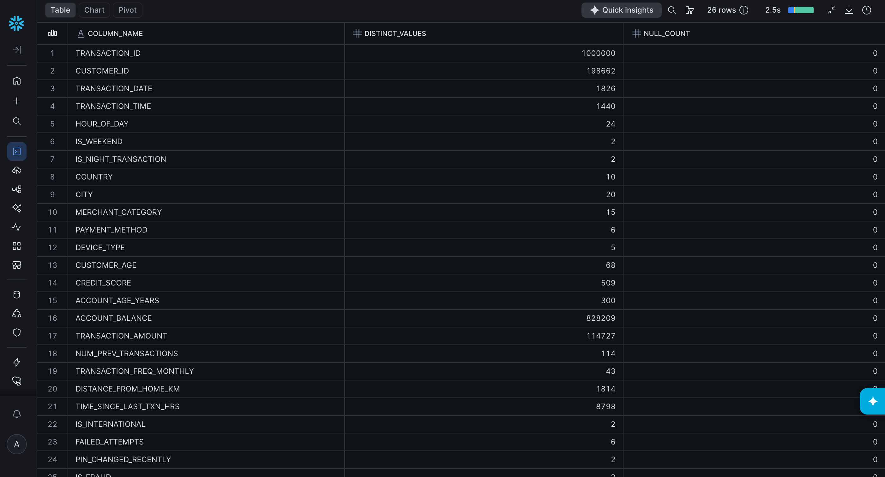
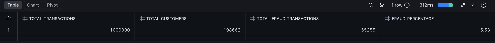
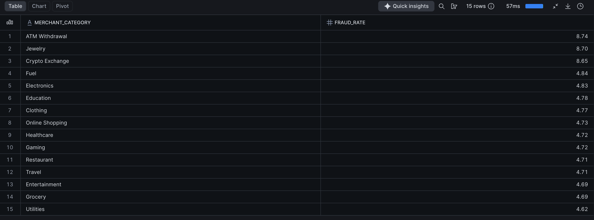

# Bank fraud detection & customer analytics 🏦

## Project overview

This project uses Snowflake SQL to analyse banking transaction data, explore customer behaviour and investigate patterns associated with fraudulent activity. It combines data exploration, customer analytics and fraud pattern analysis to demonstrate how SQL can transform raw data into meaningful insights that support business decisions and financial risk analysis.

The project is organised into three analytical modules, covering data profiling, customer behaviour and fraud patterns.

## Project objectives

- Assess transaction data quality and understand the structure of the dataset.
- Measure transaction volumes, customer counts and overall fraud rates.
- Explore customer spending patterns, demographics and account characteristics.
- Compare fraud rates across payment methods, device types, merchant categories and age groups.
- Investigate potential temporal patterns in fraudulent transactions.

## 🛠️ Tech stack

- **Snowflake:** Cloud data platform for querying and analysing banking data.
- **SQL:** Data exploration, aggregation, profiling and analytical queries.
- **GitHub:** Version control and project documentation.

## 📂 Project Structure

```text
bank-fraud-snowflake-sql/
├── screenshots/
│   ├── data_profiling.png
│   ├── fraud_overview.png
│   └── fraud_patterns.png
├── sql/
│   ├── 01_data_exploration_profiling.sql
│   ├── 02_customer_behavior.sql
│   └── 03_fraud_pattern_analysis.sql
├── .gitignore
└── README.md
```

## 📊 Analysis performed

### 1. Data exploration & profiling

**SQL file:** `sql/01_data_exploration_profiling.sql`

This module examines the dataset's structure, transaction activity and data quality.

The analysis includes:

- Total transactions, unique customers and fraudulent transactions.
- Overall fraud percentage.
- Top 10 countries by transaction volume.
- Top 10 cities by transaction value.
- Data profiling, including distinct values and null counts by column.
- Transaction distribution by payment method, device type and merchant category.



### 2. Customer behaviour analytics

**SQL file:** `sql/02_customer_behavior.sql`

This module explores customer spending patterns, demographics and account characteristics.

The analysis includes:

- Top 20 customers by total transaction amount.
- Average transaction amount across five age groups: 18–25, 26–35, 36–50, 51–65 and 65+.
- Fraud rates across age groups.
- Identification of customers with high balances, low transaction frequency and potentially dormant accounts.
- Average account balance and credit score by country.

### 3. Fraud pattern analysis

**SQL file:** `sql/03_fraud_pattern_analysis.sql`

This module investigates how fraudulent activity varies across transaction characteristics and time periods.

The analysis includes:

- Fraud rates by merchant category.
- Fraud rates by payment method.
- Fraud rates by device type.
- Distribution of fraud types by transaction count and percentage.
- Comparison of fraudulent transactions during night versus day.
- Comparison of fraudulent transactions on weekends versus weekdays.





## Skills demonstrated

- SQL querying and data aggregation
- Data exploration and profiling
- Data quality assessment
- Percentage calculations and fraud rate analysis
- Customer segmentation and behavioural analytics
- Demographic and geographic analysis
- Pattern identification and comparative analysis
- Snowflake data analysis
- Translating business questions into analytical queries

## Business value

The analysis explores how transaction characteristics, customer behaviour and demographic segments relate to fraudulent activity. These insights can help inform further investigation, support fraud risk monitoring and improve understanding of transaction patterns.

The results are intended for analytical exploration and do not independently establish whether a transaction or customer is fraudulent.

## About this project

This project demonstrates my practical application of SQL and Snowflake to a financial analytics use case. It combines structured data exploration with customer behaviour analysis and fraud pattern investigation, reflecting my interest in using data to understand business problems and support evidence based decision making.
